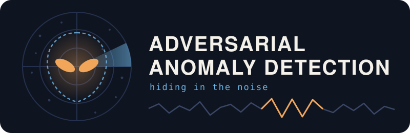

<p align="center">
  
</p>

<p align="center">
  <a href="LICENSE"></a>
  <a href="covariance/CHANGELOG_v1.4.2.md"></a>
  
  
  
  
  
  
  
  
</p>

# Adversarial Anomaly Detection Under Correlated Backgrounds

> **How do you detect a hidden actor that knows how you are trying to detect it?**

A reproducible research project on ON/OFF anomaly detection when an adaptive actor can shrink its footprint, contaminate the observer's controls, exploit correlated background noise, and respond strategically to the observer's test design. Presented as **"Hiding in the Noise"** at the AI InTheRock Local AI Showcase, North Little Rock, November 2026.

> **Status:** research prototype. **All data are synthetic.** Nothing here is evidence that any hidden or concealed population exists. The framework describes what evidence would have to look like for such a hypothesis to become distinguishable from ordinary processes.

## Quickstart (Ubuntu 24.04 LTS)

One command clones the repo, builds a Python virtual environment, installs the dependencies, reruns the verifiers and checks every regenerated table against the committed one, byte for byte:

```bash
curl -fsSL https://raw.githubusercontent.com/danindiana/adversarial-anomaly-detection/main/setup.sh | bash
```

It takes under a minute on a stock Ubuntu 24.04 machine (Python 3.12), runs on CPU only, and installs `git` and `python3-venv` with `apt-get` if they are missing. Options go in front of `bash`:

| Variable | Effect |
|---|---|
| `AAD_DIR=~/src/aad` | Clone somewhere other than `~/adversarial-anomaly-detection` |
| `AAD_FULL=1` | Also rerun the v1.3.3 Monte Carlo game (adds about a minute) |
| `AAD_PYTHON=python3.13` | Build the environment with a different interpreter (3.11+) |
| `AAD_SKIP_APT=1` | Never call `apt-get`; just report what is missing |
| `AAD_SKIP_VERIFY=1` | Install only |

For example: `curl -fsSL …/setup.sh | AAD_FULL=1 bash`. To read the script before running it:

```bash
curl -fsSLO https://raw.githubusercontent.com/danindiana/adversarial-anomaly-detection/main/setup.sh
less setup.sh && bash setup.sh
```

Or by hand:

```bash
sudo apt update && sudo apt install -y git python3-venv
git clone https://github.com/danindiana/adversarial-anomaly-detection
cd adversarial-anomaly-detection
python3 -m venv .venv && source .venv/bin/activate
pip install -r framework/requirements.txt -r covariance/requirements.txt
```

## Origin

The work began as a deliberately speculative thought experiment. Assume some mixture of these is true:

1. Intelligent nonhuman life has been present on Earth throughout human evolution.
2. It lives among us in stealth, practically indistinguishable from humans. (On concealed "cryptoterrestrial" hypotheses, see [Lomas, Case & Masters, 2024](https://static.foxnews.com/foxnews.com/content/uploads/2024/06/ThecryptoterrestrialhypothesisLomasetal.J2024.pdf).)
3. It follows something like a prime directive: no steering of human affairs.
4. It is indifferent to us except for planet-scale effects: climate, nuclear war, bioweapon release.

The question became: **what could observation ever reveal?** Within a few rounds the speculative premise dropped out of the mathematics, leaving a general methods problem in adversarial anomaly detection and robust experimental design. The same questions arise in fraud detection, tampered sensors, network intrusion and poisoned training data.

The project was carried out by relaying versioned research packages between two AI systems that built, re-ran and critiqued each other's work, with a human operator directing it (see [Provenance](#provenance)).

## Main results (all within the synthetic models)

| Finding | Result |
|---|---|
| Perfect mimicry is undetectable | If presence leaves the observed distribution unchanged, the Bayes factor is exactly 1 forever. |
| Raw counts are weak evidence | When background uncertainty dominates, a nominal excess of anomalous reports barely moves the Bayes factor; a few high-specificity measurements beat large ambiguous catalogs. |
| Hiders exploit uncalibrated noise | Under a log concealment cost, the optimal footprint is `s* = √(κV)` and the optimal divergence is `KL* = κ/2`, independent of `V`. Calibration shrinks the footprint; it does not make the hider easier to catch. |
| Single-channel ON/OFF is not identifiable | With only ON counts, unlimited replication estimates `B + s`, never the components. An independent OFF control is required. |
| Check that comparisons agree | Against a hider shifting 4 of 8 controls (`τ = 0`, `s = 10`, all 8 measured), a mean-only test detects ~20%; an omnibus test of equality across channels detects ~84%. Partial contamination is itself evidence. |
| Uncalibrated spread is attackable | Estimating heterogeneity from the controls lets a hider inject spread: two ±δ controls drop power from 0.99 to 0.55 (δ = 10) with 8 controls. |
| Randomize tests, not just controls | The exact mixed-policy frontier (LP) drives contamination willingness-to-pay to zero at plain-activity hider utility 0.146 vs 0.202 for the best single test (`τ = 0`). |
| Hiders mostly do less | Better cross-channel testing usually pushes the hider toward a smaller footprint; whether it still contaminates depends on contamination cost relative to its willingness to pay. |
| Known covariance does not neutralize an aligned attack | With clustered covariance known exactly, a cluster-aligned shift loses ~54% of its noncentrality while a misaligned one gains ~80% (`ρ = 0`, `c = 4`). Some directions are genuinely noisier than others. |

## Current milestone: the protected-covariance benchmark (v1.4.2)

In this regime the observer knows the true covariance matrix `Σ`, which separates intrinsic geometric difficulty from later losses caused by covariance estimation or poisoning. For a footprint direction `u` (fixed physical normalization), the concealment scale is

```
C(u, Σ) ∝ 1 / sqrt(uᵀ Σ⁻¹ u)
C*(Σ, U) = max_{u ∈ U, ‖u‖ = 1}  1 / sqrt(uᵀ Σ⁻¹ u)
```

If every unit direction were feasible, the easiest direction to hide in would be the principal variance direction, giving `C* = sqrt(λ_max(Σ))`. In practice a hidden actor's physical needs constrain the feasible set `U`, and concealment gets expensive when those needs force its footprint away from the background's high-variance directions.

## Repository layout

```
framework/            Core series, v1.0.0 → v1.3.6 (each release replaced this folder; see git history)
covariance/           Covariance stage, v1.4.0 → v1.4.2 (protected / known-Σ analytic benchmark)
independent-checks/   Scripts used to independently re-run and probe each release
SHOWCASE.md           Live-demo framing and collaboration asks
assets/logo.svg       Project logo
setup.sh              One-shot setup and verification script (Ubuntu 24.04)
docs/                 Annotated additional reading
slides/               Showcase talk and math deck (PDF/PPTX)
CITATION.cff          How to cite this repository
```

Each release is a commit with a matching tag (`v1.0.0` … `v1.4.2`), so `git diff v1.3.2 v1.3.3` shows exactly what a correction changed. Every package ships a `SHA256SUMS.txt` manifest. The v1.2.0 package shipped compiled Python bytecode; it was left out here, so that release's manifest lists two `.pyc` files that are absent.

`framework/README.md` was carried forward unchanged from v1.3.2; the current core notes are `framework/Reach_Limited_Contamination_ON_OFF_v1.3.5.md` and `framework/README_v1.3.5.md`. The current covariance note is `covariance/PROTECTED_BENCHMARK_v1.4.2.md`.

## Reproducing

`setup.sh` (see [Quickstart](#quickstart-ubuntu-2404-lts)) runs all of this. To run the steps yourself, with Python 3.11+:

```bash
python3 -m venv .venv
source .venv/bin/activate
pip install -r framework/requirements.txt -r covariance/requirements.txt

# Protected-covariance benchmark (v1.4.2) and its five invariants:
# model reduction, common-mode cancellation, simulated null size,
# analytic-vs-simulated power, and cell-level regression against v1.3.3
cd covariance
python verify_protected_v1_4_2.py \
  --archive-frontier mixed_policy_frontier_v1_3_5.csv \
  --archive-cells joint_strategy_results_v1_3_3.csv \
  --output-dir out
cd ..

# Core game (Monte Carlo) and the v1.3.4 / v1.3.5 reporting and mixed-frontier tables
cd framework
python verify_models_v1_3_3.py --output-dir out
python verify_reporting_v1_3_4.py --input joint_strategy_results_v1_3_3.csv --output-dir out
python verify_models_v1_3_5.py --input joint_strategy_results_v1_3_3.csv --output-dir out
```

Generated tables should match the packaged ones byte for byte. The v1.4.2 seeded simulation uses Cholesky factorization, so results agree across numpy/LAPACK builds.

## Version history

| Tag | What changed |
|---|---|
| v1.0.0 | Model comparison framework: Poisson–Gamma detection, secrecy hazard, genomic sampling, warden vs cohabitant intervention, first adversarial hider. |
| v1.1.0 | Closed form `s* = √(κV)`, `KL* = κ/2`; ON-only non-identifiability; toy Stackelberg game with a randomized control. |
| v1.2.0 | Coverage game over many controls; between-channel heterogeneity `τ`; false alarms under misspecified `τ`. |
| v1.3.0 | Joint hider strategy (signal, reach, level/spread/mixed attacks); robust scale estimators; size-valid calibration filter. |
| v1.3.1 | Observer gains omnibus and combined (exchangeability) tests. |
| v1.3.2 | Fine signal grid and utility sweep; retitled as a methods study. |
| v1.3.3 | Symmetric attack grid; contamination-cost sweep and willingness-to-pay. Corrects "contamination is rarely chosen". |
| v1.3.4 | Reporting: size-validity flags, grid-ceiling lower bounds, pure-policy robustness–efficiency frontier. |
| v1.3.5 | Exact mixed-policy frontier by linear programming; reproducible post-processor for the v1.3.4 tables. |
| v1.3.6 | Dependency fix (`pandas`). |
| v1.4.0 | Protected-covariance analytic benchmark with clustered `Σ`; alignment made a hider choice. |
| v1.4.1 | Real end-to-end simulation invariants; cell-level regression against v1.3.3. |
| v1.4.2 | Cholesky sampling for cross-platform reproducibility; documented basis for the regression bound. |

## Corrections made along the way

Claims are versioned and revised when counterexamples or reproducibility failures are found. Both AI systems had claims retracted. Some examples:

- **Secrecy.** An early argument that a hidden group "would have leaked by now" used an invented leak rate. With a published estimate of secrecy failure (Grimes, 2016), a group growing to ~1,000 over a century has ~80% odds of no exposure.
- **Calibration.** "Noisier backgrounds let a hider do 3× more" is true for footprint, but the closed form shows optimized detectability is identical; calibration suppresses rather than catches.
- **Square-root steganography law.** Applied too broadly; it is conditional on imperfect hiding.
- **"Contamination is rarely chosen."** An artifact of fixed contamination costs and a coarser contaminated-strategy grid; at zero cost it is chosen in 20–27 of 27 settings.
- **Pure vs mixed frontier.** The pure-policy frontier overstated the robustness–efficiency tradeoff by 17–28%.
- **Verifier hygiene.** A size invariant that could never fail, a regression tolerance chosen just above the observed error, and SVD-based sampling that was not reproducible across machines were all replaced.

## Roadmap

The next stage is finite-`T` covariance estimation without poisoning:

1. How quickly does the estimated-covariance frontier converge to the protected benchmark as calibration length `T` grows? (With `Ω̂` estimated from `T` periods, the whitened statistic follows a scaled `F(k, T − k)`, not `χ²_k`; this needs `T > k`.)
2. How do full versus structured covariance estimators trade statistical efficiency against misspecification risk?
3. How much extra concealment value comes from estimation error beyond the intrinsic protected geometry? Measured as a frontier shift `Δ(w) ≥ 0` at fixed contamination willingness-to-pay `w` and fixed effort `(E[k], T)`.
4. Later: what changes when an adaptive actor can poison the calibration process itself, and does private randomization of calibration membership help?

## Showcase and collaboration

See [SHOWCASE.md](SHOWCASE.md) for the live-demo concept. We are especially interested in:

- real multichannel datasets where background covariance matters: sensor networks, industrial telemetry, network traffic, power systems, environmental monitoring, RF measurements;
- datasets with a **known** hidden actor (seeded fraud, red-team logs, sensor-spoofing trials), so predictions can be tested where the answer is known;
- statistical criticism of the covariance model, robust covariance estimation, and adversarial-detection or cybersecurity perspectives.

## Ethics

The framework is meant for aggregate, infrastructure-level analysis. Applied to individuals it is both statistically hopeless and harmful: with 1,000 hypothetical hidden actors among 8 billion people, a test with a 1-in-10,000 false-alarm rate flags ~800,000 ordinary people for every 1,000 true positives, and a strategic actor would sit among already-marginalized groups. Do not use it to score individuals.

## Provenance

- Research packages (models, code, notes), the curated v1.4.2 presentation, roadmap and showcase framing: ChatGPT (OpenAI).
- Independent re-runs, critiques, the scripts in `independent-checks/`, and assembly of the tagged history: Claude (Anthropic).
- Direction, relay between the two systems, and decisions about what held up: Benjamin W. Denio.

## References

For 30 annotated papers across adversarial ML, robust statistics, multichannel detection, information hiding, sensor fusion and imperfect detection, see [docs/additional-reading.md](docs/additional-reading.md).

- Cachin, C. (1998). An information-theoretic model for steganography. *Information Hiding*, LNCS 1525.
- Ćirković, M. M., Sandberg, A., & Bostrom, N. (2010). Anthropic shadow. *Risk Analysis* 30(10).
- Grimes, D. R. (2016). On the viability of conspiratorial beliefs. *PLOS ONE* 11(1), with correction.
- Ker, A. D., Pevný, T., Kodovský, J., & Fridrich, J. (2008). The square root law of steganographic capacity. *MM&Sec*.
- Li, T.-P., & Ma, Y.-Q. (1983). Analysis methods for results in gamma-ray astronomy. *ApJ* 272.
- Lomas, T., Case, B., & Masters, M. P. (2024). The cryptoterrestrial hypothesis: A case for scientific openness to a concealed earthly explanation for Unidentified Anomalous Phenomena. *Philosophy and Cosmology* 33. [PDF](https://static.foxnews.com/foxnews.com/content/uploads/2024/06/ThecryptoterrestrialhypothesisLomasetal.J2024.pdf). The authors present it as a hypothesis deserving openness, not one they consider likely.

## Citation

See [CITATION.cff](CITATION.cff).

## License

MIT. See [LICENSE](LICENSE).
