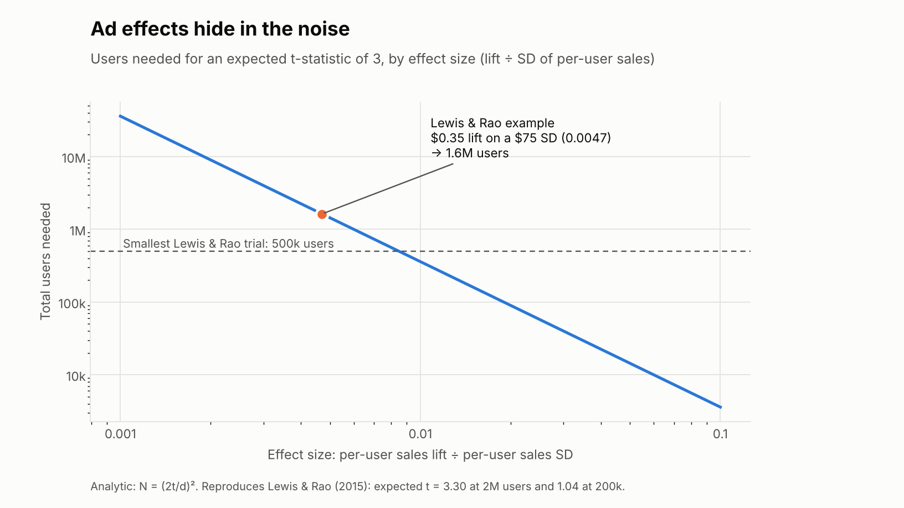
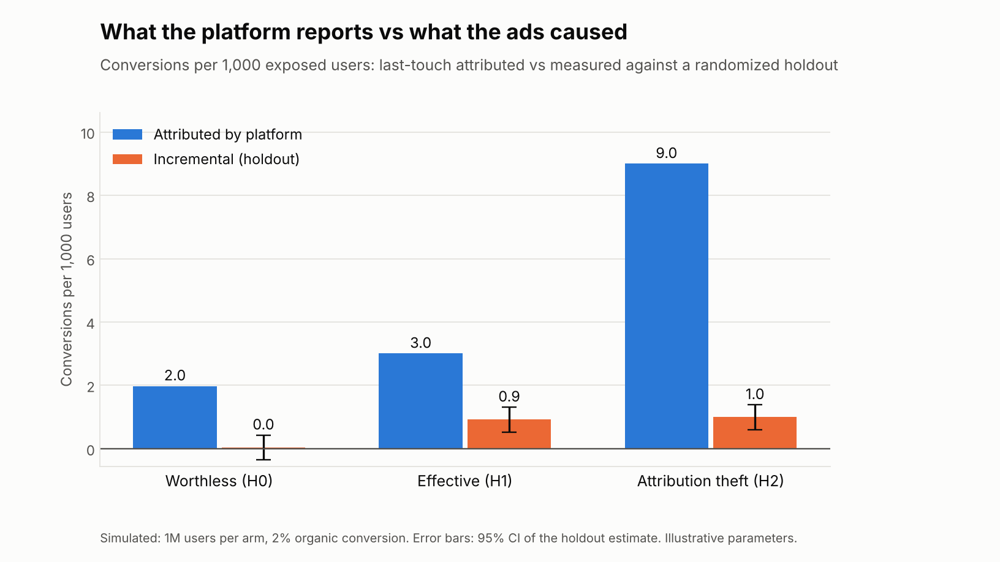
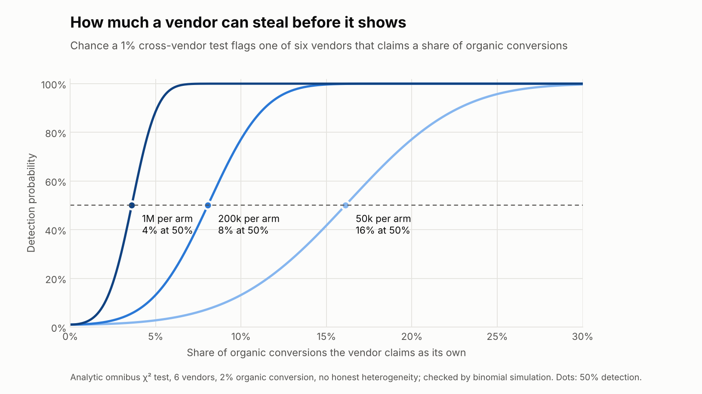
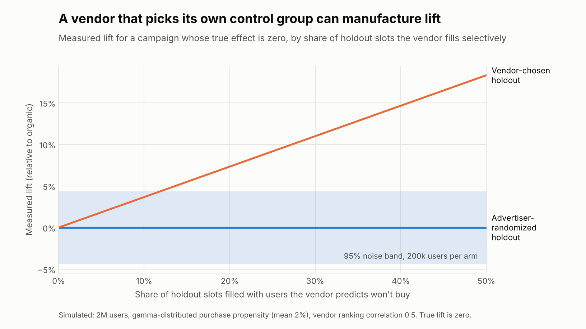
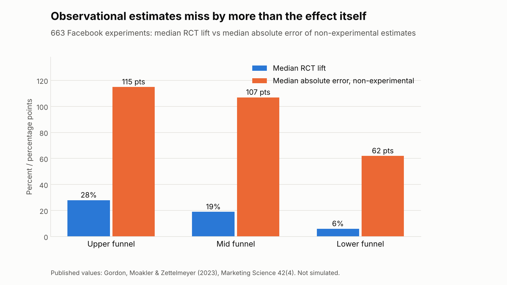
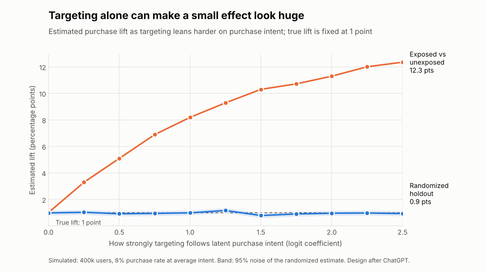
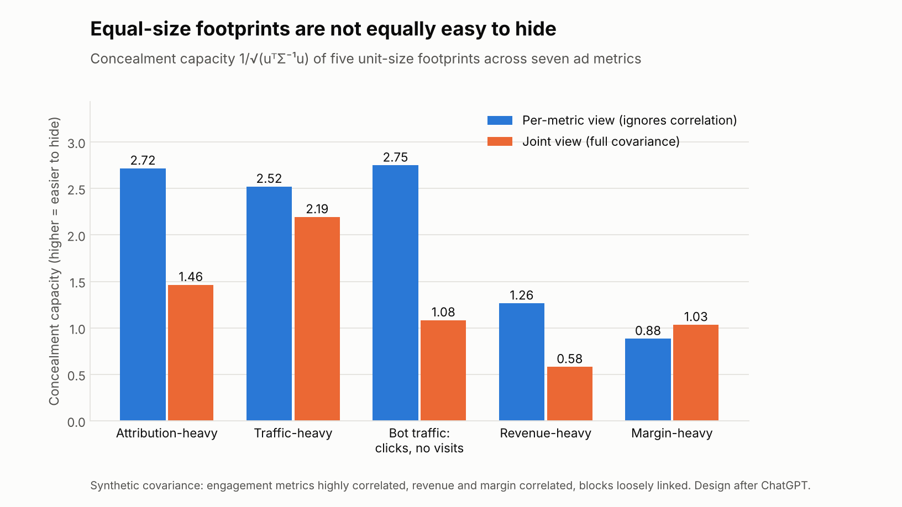

# Application: advertising measurement and ad fraud

> **How much of an apparent advertising signal survives once selection, attribution, fraud, background noise and measurement incentives are separated from what the ads actually caused?**

This section applies the project's framework to a domain where the hidden, adaptive actor is real: digital advertising. It was prompted by Don Marti's post [*So much crime, so little pay*](https://blog.zgp.org/so-much-crime-so-little-pay/) (March 2026), which argues that surveillance advertising delivers little growth to the brands paying for it while fraud and intermediaries capture the value.

> **Status:** application note with a reproducible synthetic case study. One figure uses published values; the other six are synthetic, with every parameter stated. Nothing here measures any real platform, vendor or campaign. It does **not** claim that digital advertising is generally ineffective, that any company commits fraud, or that a gap between attribution and incrementality is itself proof of fraud.

## Why advertising fits the framework

Advertising measurement combines all three features the framework was built for:

1. **The treatment is targeted, not randomly assigned.** People likely to buy anyway are the ones most likely to see the ad.
2. **The measurement layer is often controlled by, or paid alongside, the delivery layer.** The same system that shows the ad also reports its effect.
3. **The outcomes are many, noisy and correlated.** Spend, impressions, clicks, attributed conversions, visits, revenue and margin move together for ordinary reasons.

| Framework concept | In advertising |
|---|---|
| Hidden actor with limited reach | A vendor, network or bot operation that can touch some measurement channels but not others |
| Uncalibrated background noise `V` | Enormous per-customer sales variance relative to any ad effect |
| ON/OFF design with a control channel | A randomized holdout group that never sees the ad |
| Contaminated control | A holdout group the vendor chooses or can identify |
| Cross-channel consistency (omnibus test) | Do vendors' attribution claims agree with each other and with holdout lift? |
| Matching marginals vs the joint distribution | Bot traffic that looks right metric by metric but not in combination |
| Protected calibration | An advertiser-randomized holdout the vendor cannot see |

## What the empirical literature already shows

1. **Ad effects are tiny relative to noise.** Lewis & Rao (2015) analyzed 25 large display-ad field experiments (about $2.8M of spend). The standard deviation of individual sales is typically about ten times its mean, and the median 95% confidence interval on ROI is more than 100 percentage points wide. In their example, a campaign with a 25% ROI is indistinguishable from zero at 200,000 users.
2. **Observational measurement misses by more than the effect itself.** Gordon, Zettelmeyer, Bhargava & Chapsky (2019) compared observational methods with 15 randomized Facebook experiments. In one study the true lift was 2.4% and the closest observational estimate was 1,306%. Gordon, Moakler & Zettelmeyer (2023) extended this to 663 experiments; see Figure 5.
3. **Some paid advertising buys sales that would have happened anyway.** Blake, Nosko & Tadelis (2015) found that eBay's brand-keyword search ads had no measurable short-term benefit, and that non-brand returns were concentrated among new and infrequent users.
4. **Advertising can still work, and its effects vary.** A 3-million-user retail experiment found a 3.6% sales increase (Johnson, Lewis & Reiley, 2017); retargeting caused 14.6% more users to return within four weeks (Sahni, Narayanan & Kalyanam, 2019); and giving 7,209 of 18,294 restaurants free Yelp ads raised purchase-intention outcomes by 7–19%, with larger gains for some kinds of business (Dai, Kim & Luca, 2023). The framework is not a blanket null.
5. **Invalid traffic is a real measurement channel.** Springborn & Barford (2013) documented pay-per-view networks that render hidden ads in real users' browsers, inflating impression counts with no human attention behind them. Herley (2026) bounds the fraction of script-generated traffic in a human/bot mixture using structural relationships between features: matching individual metrics is easier than matching how they co-vary.

**Two cautions on the motivating evidence.** The slow-growth comparisons in Marti's post (large advertisers growing at roughly 2% a year against about 4.7% nominal GDP) are aggregate residuals with a huge background: industry mix, maturity, acquisitions, pricing and the macroeconomy. Advertising is also endogenous; struggling firms may advertise more *because* they are struggling. By the project's own standard that is suggestive, not causal. The decisive evidence is randomized.

## Case study: seven results

All synthetic results share a 2% organic conversion rate. Figures render in light or dark to match your GitHub theme.

### 1. Ad effects hide in the noise

<picture>
  <source media="(prefers-color-scheme: dark)" srcset="figures/noise_floor-dark.png">
  
</picture>

A two-arm experiment split evenly has expected t-statistic `d·√N / 2`, where `d` is the per-user lift divided by the per-user sales SD. That reproduces Lewis & Rao exactly: t = 3.30 at 2M users and 1.04 at 200k. Their example campaign needs **1.6 million users** to reach t = 3.

In framework terms this is the uncalibrated variance `V` from v1.1, where a hider's safe footprint scales as `√(κV)`. When per-customer sales vary this much, a worthless or fraudulent channel can be large and stay invisible for years, which is how "so little pay" can persist without anyone proving it.

### 2. What the platform reports vs what the ads caused

<picture>
  <source media="(prefers-color-scheme: dark)" srcset="figures/attribution_gap-dark.png">
  
</picture>

Three illustrative campaigns, 1M users per arm, following ChatGPT's three hypotheses:

- **H0, worthless.** The ads cause nothing, but targeting means last-touch attribution still credits about 2 organic conversions per 1,000 users to the ad.
- **H1, effective.** The ads cause about 1 conversion per 1,000; attribution reports about three times that, the size of gap Gordon et al. found in half their studies.
- **H2, attribution theft.** The same real effect as H1, plus click injection that stamps a last touch onto conversions that were going to happen anyway. Attribution reports 9; the holdout still shows about 1.

The holdout cannot be fooled by attribution, but attribution alone cannot tell H0, H1 and H2 apart. That is the framework's non-identifiability result: the channel the actor controls cannot clear the actor.

### 3. How much a vendor can steal before it shows

<picture>
  <source media="(prefers-color-scheme: dark)" srcset="figures/theft_detection-dark.png">
  
</picture>

Six vendors each get an advertiser-run randomized holdout. For each vendor, the observer computes **excess attribution**: attributed conversions minus holdout-measured incremental conversions. Honest vendors' excess should agree up to noise, so a cross-vendor omnibus test (the v1.3.1 exchangeability test) flags a vendor whose excess stands out. One vendor steals a share of organic conversions.

| Users per arm, per vendor | Share of organic conversions a thief can claim at 50% detection |
|---|---:|
| 50,000 | 16% |
| 200,000 | 8% |
| 1,000,000 | 4% |

Two further results from the framework apply directly:

- **Honest heterogeneity is where theft hides.** Vendors target differently, so honest excess attribution varies between them (between-vendor SD `τ`). At 200k users per arm, the 50%-detection threshold rises from 8% to 12% at `τ` = 0.5 conversions per 1,000, and to 20% at `τ` = 1 per 1,000. This is the v1.2 `τ` result.
- **Ignoring that heterogeneity is worse.** If the observer assumes `τ` = 0 when it is 0.5 or 1 per 1,000, the nominal 1% test raises false alarms **25%** or **78%** of the time, accusing honest vendors.

The analytic power is checked against a direct binomial simulation of all six vendors (simulated power 0.49 at the 8% point). The simulated false-alarm rate is 0.7% rather than the nominal 1%, because the analytic variance slightly overstates the noise; the stated thresholds are therefore conservative.

### 4. Who controls the holdout

<picture>
  <source media="(prefers-color-scheme: dark)" srcset="figures/holdout_control-dark.png">
  
</picture>

Some lift studies are run by the vendor being measured. If the vendor fills part of the holdout with users its model predicts won't buy, a campaign with **zero** true effect shows positive lift:

| Holdout slots the vendor fills selectively | Fake lift (relative to organic) |
|---|---:|
| 10% | +3.7% |
| 25% | +8.8% |
| 50% | +18.3% |

The 95% noise band at 200k users per arm is ±4.3%, so at 25% the fake lift is already well outside it. This is the framework's "attackable calibration" stage in concrete form: a contaminated control does not just hide an effect, it manufactures one. The remedy is the same as in v1.1: **the advertiser randomizes the holdout privately**, so the vendor cannot see or shape it.

### 5. Observational estimates miss by more than the effect itself (published data)

<picture>
  <source media="(prefers-color-scheme: dark)" srcset="figures/gordon2023_observational_error-dark.png">
  
</picture>

Across 663 Facebook experiments, the median absolute error of non-experimental estimates (115, 107 and 62 percentage points for upper-, mid- and lower-funnel outcomes) is several times the median true lift (28%, 19% and 6%). These are published values, not a simulation.

### 6. Targeting alone can make a small effect look huge

<picture>
  <source media="(prefers-color-scheme: dark)" srcset="figures/selection_bias-dark.png">
  
</picture>

Why observational estimates miss (Figure 5) in one picture. Each user has a latent purchase intent; the ad adds exactly one percentage point to everyone's purchase probability. As targeting leans harder on intent, the naive exposed-vs-unexposed comparison climbs from 1.0 to **12.3 points**, because the exposed group is full of people who were going to buy anyway. The randomized holdout stays at about 1 point throughout. No fraud is involved: selection alone produces a twelvefold overstatement.

### 7. Equal-size footprints are not equally easy to hide

<picture>
  <source media="(prefers-color-scheme: dark)" srcset="figures/covariance_geometry-dark.png">
  
</picture>

The protected-covariance result from v1.4, on seven synthetic ad metrics (spend, impressions, clicks, attributed conversions, visits, revenue, margin). Every footprint has the same size; what differs is its direction. Concealment capacity is `1/√(uᵀΣ⁻¹u)`, and the per-metric view computes the same thing while ignoring correlations.

- **Bot traffic is the clearest case.** Clicks and impressions rise but visits do not. Metric by metric it looks like the easiest thing to hide (2.75); jointly it is **2.5 times harder** (1.08), because clicks and visits normally move together and this footprint breaks that link. This is Herley's point, and the framework's: matching each metric is easy, matching how they co-vary is not.
- **Moving with the grain is cheap.** A traffic-heavy footprint, which raises impressions, clicks and visits together the way ordinary demand does, keeps most of its cover (2.19). Margin-heavy is the one case where the joint view gives *more* cover than the per-metric view, because revenue and margin normally move together.
- **Rankings change.** Which footprint looks easiest to hide depends on whether correlations are modeled, so a detector that checks metrics one at a time is aiming at the wrong targets.

The covariance is illustrative, not estimated from real data; estimating it from protected holdout periods is the finite-`T` problem in the main project.

## A multichannel test (proposed)

ChatGPT's extension, in the project's notation. Let the observable vector be

```
X_t = [ad spend, impressions, clicks, attributed conversions, visits, revenue, gross margin, ...]
```

with ordinary covariance `Σ`. A real advertising effect should leave a coherent footprint `s·u` that propagates downstream (exposure → demand → sales → margin); its detectability is `λ = s² uᵀ Σ⁻¹ u`. An attribution-only or invalid-traffic effect moves the cheap-to-move channels (impressions, clicks, attributed conversions) without the matching movement in revenue or margin.

1. Choose outcome channels with different measurement owners where possible.
2. Estimate the background covariance `Σ̂_T` from protected (advertiser-randomized) holdout periods.
3. Estimate the treatment-minus-control effect vector `δ̂`.
4. Compute `Q = δ̂ᵀ Σ̂_T⁻¹ δ̂`, and compare the direction of `δ̂` with pre-declared footprint families: attribution-heavy, traffic-heavy, revenue-heavy, margin-heavy.
5. Report causal lift and cross-channel consistency together, never a single platform metric.

Because `Σ̂_T` is estimated rather than known, this is exactly the v1.4 finite-`T` stage of the main project.

**Metric gaming, in general.** Moving evaluation from platform attribution to protected randomized incrementality shrinks the set of directions `U` a measurement-gaming actor can use, so its concealment capacity cannot increase: `C*_protected ≤ C*_old`. If reported performance collapses after such a switch, the old "signal" lived in an attackable measurement channel. That says where the signal was, not that anyone committed fraud. The same question, *which directions can an actor move cheaply inside the observer's background covariance?*, applies wherever people are paid on a metric: hospital and school indicators, corporate KPIs, benchmarks, AI evaluations.

## Falsifiable predictions

1. Observational attribution error is largest along poorly constrained covariance directions.
2. Adding independent downstream channels reduces apparent lift when the original signal is mostly attribution or invalid traffic.
3. Advertiser-randomized holdouts reduce the value of measurement-channel manipulation.
4. As clean calibration length `T` grows, the estimated-covariance loss converges to the protected benchmark.
5. A genuinely causal effect does not disappear when the observer switches to a protected measurement channel.

Failure of these would weaken, or force revision of, the transfer from the anomaly-detection framework to advertising.

## Next step: real randomized data

The [Criteo uplift dataset](https://ailab.criteo.com/criteo-uplift-prediction-dataset/) is the natural first test bed: about 14 million users from Criteo's randomized incrementality tests, with 12 anonymized features, a treatment flag (about 85% treated), an exposure flag, and visit and conversion outcomes over two weeks (Diemert et al., 2021). Plan:

1. Use treatment-vs-control lift as the protected causal anchor.
2. Reconstruct exposure-based observational estimates and measure their gap from the anchor.
3. Plant synthetic attribution thieves with known reach and cost; measure how well holdout-consistency tests catch them as they adapt.
4. Estimate feature covariance and test whether the framework's geometry predicts where observational bias lives.

Steps 1, 2 and 4 are now a runnable pipeline in [`criteo/`](criteo/README.md), with randomized anchor figures from published aggregates, bootstrap intervals, a weak-first-stage guard and a synthetic end-to-end test. The data is not redistributed here (CC BY-NC-SA 4.0); the row-level run is still pending. Step 3 is not built yet.

## Reproducing

```bash
pip install -r adfraud/requirements.txt
python adfraud/adfraud_case_study.py               # writes results.json, results.csv and figures/
python adfraud/adfraud_case_study.py --no-figures  # numbers only; needs just numpy and scipy
```

It runs in a few seconds and checks itself: it asserts that it reproduces Lewis & Rao's reported t-statistics, and that the analytic detection power matches a direct binomial simulation. `setup.sh` reruns it and compares `results.csv` byte for byte.

## References

- Blake, T., Nosko, C., & Tadelis, S. (2015). Consumer heterogeneity and paid search effectiveness: A large-scale field experiment. *Econometrica* 83(1), 155–174. [doi:10.3982/ECTA12423](https://doi.org/10.3982/ECTA12423)
- Dai, W., Kim, H., & Luca, M. (2023). Which firms gain from digital advertising? Evidence from a field experiment. NBER Working Paper 30925. [nber.org/papers/w30925](https://www.nber.org/papers/w30925)
- Diemert, E., Betlei, A., Renaudin, C., Amini, M.-R., Gregoir, T., & Rahier, T. (2021). A large scale benchmark for individual treatment effect prediction and uplift modeling. [arXiv:2111.10106](https://arxiv.org/abs/2111.10106)
- Gordon, B. R., Zettelmeyer, F., Bhargava, N., & Chapsky, D. (2019). A comparison of approaches to advertising measurement: Evidence from big field experiments at Facebook. *Marketing Science* 38(2), 193–225. [doi:10.1287/mksc.2018.1135](https://doi.org/10.1287/mksc.2018.1135)
- Gordon, B. R., Moakler, R., & Zettelmeyer, F. (2023). Close enough? A large-scale exploration of non-experimental approaches to advertising measurement. *Marketing Science* 42(4), 768–793. [Kellogg summary](https://www.kellogg.northwestern.edu/academics-research/research/detail/2023/close-enough-a-large-scale-exploration-of-non-experimental/)
- Herley, C. (2026). Estimating the amount of script-generated traffic in a mixture. *USENIX Security 2026*. [usenix.org](https://www.usenix.org/conference/usenixsecurity26/presentation/herley)
- Johnson, G. A., Lewis, R. A., & Reiley, D. H. (2017). When less is more: Data and power in advertising experiments. *Marketing Science* 36(1), 43–53. [doi:10.1287/mksc.2016.0998](https://doi.org/10.1287/mksc.2016.0998)
- Johnson, G. A., Lewis, R. A., & Nubbemeyer, E. I. (2017). Ghost ads: Improving the economics of measuring online ad effectiveness. *Journal of Marketing Research* 54(6). [Kellogg summary](https://www.kellogg.northwestern.edu/faculty/research/detail/2017/ghost-ads-improving-the-economics-of-measuring-online-ad)
- Lewis, R. A., & Rao, J. M. (2015). The unfavorable economics of measuring the returns to advertising. *Quarterly Journal of Economics* 130(4), 1941–1973. [doi:10.1093/qje/qjv023](https://doi.org/10.1093/qje/qjv023)
- Marti, D. (2026). So much crime, so little pay. [blog.zgp.org](https://blog.zgp.org/so-much-crime-so-little-pay/) (motivating commentary, not causal evidence)
- Sahni, N. S., Narayanan, S., & Kalyanam, K. (2019). An experimental investigation of the effects of retargeted advertising: The role of frequency and timing. *Journal of Marketing Research* 56(3). [Stanford GSB](https://www.gsb.stanford.edu/faculty-research/publications/experimental-investigation-effects-retargeted-advertising-role)
- Springborn, K., & Barford, P. (2013). Impression fraud in on-line advertising via pay-per-view networks. *USENIX Security 2013*. [usenix.org](https://www.usenix.org/conference/usenixsecurity13/technical-sessions/paper/springborn)

## Provenance

The literature review, the H0/H1/H2 framing, the multichannel test, the metric-gaming generalization, the falsifiable predictions and the designs of Figures 6 and 7 were drafted by ChatGPT. The case-study code, figures and numbers were built by Claude (Figures 6 and 7 rebuilt from ChatGPT's designs with stated parameters so they regenerate from the script), which also checked every citation against its source and corrected details (for example, the Yelp study randomized 7,209 of 18,294 restaurants, not all of them). Direction by Benjamin W. Denio.
