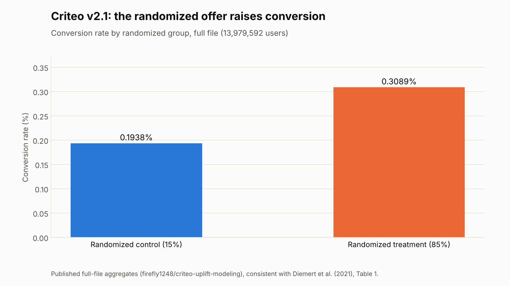
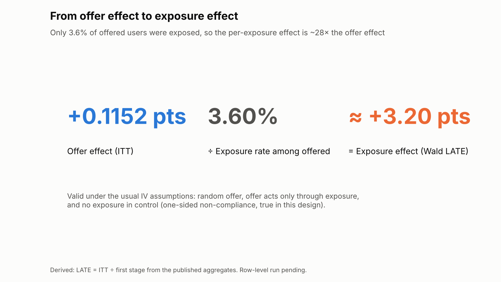

# Criteo: the first real-data test

> **Does exposure-attribution error concentrate where the framework's covariance geometry says selection can hide?**

> **Status:** pipeline built and tested end to end on synthetic data with a known answer. **The real Criteo run has not happened yet**: neither environment that built this could download the file. No row-level result is claimed below. The two anchor figures use published full-file aggregates only.

## Why Criteo

[Criteo Uplift v2.1](https://ailab.criteo.com/criteo-uplift-prediction-dataset/) comes from randomized incrementality tests: 13,979,592 users, each with 12 anonymized pre-treatment features and four columns.

| Column | Role |
|---|---|
| `treatment` (Z) | Randomized offer: the user may be shown ads (85%) or is held out (15%). The **protected** channel. |
| `exposure` (A) | Whether an ad was actually shown. Selected by the auction, so **endogenous**. Never 1 in control. |
| `visit`, `conversion` (Y) | Outcomes over the following two weeks. |

Version 2.1 replaced an earlier release that leaked advertiser information. The dataset is licensed CC BY-NC-SA 4.0, so this repository never stores it; `data/` is git-ignored.

Per Diemert et al. (2021, Table 2), 4 features are continuous (f0, f2, f7, f10) and 8 are hashed categorical codes with 60 to 3,743 values each.

## The randomized anchor (published aggregates)

<picture>
  <source media="(prefers-color-scheme: dark)" srcset="figures/criteo_v21_conversion_rates-dark.png">
  
</picture>

<picture>
  <source media="(prefers-color-scheme: dark)" srcset="figures/criteo_v21_itt_to_late-dark.png">
  
</picture>

| Quantity | Value |
|---|---:|
| Control conversion | 0.1938% |
| Treatment conversion | 0.3089% |
| Offer effect (ITT) | +0.1152 points |
| Exposure among treated (first stage) | 3.60% |
| Exposure effect (Wald LATE = ITT ÷ first stage) | ≈ +3.20 points |

The first four come from a public full-file recomputation ([firefly1248/criteo-uplift-modeling](https://github.com/firefly1248/criteo-uplift-modeling)), not from this repository. They agree with the dataset paper: 0.85 × 0.3089% + 0.15 × 0.1938% = 0.29% overall conversion (Table 1: 0.29%), and 0.1152 / 0.3089 = 37.3% relative uplift (Table 1: 37.2%, so the paper takes relative uplift over the treated rate). The LATE is valid under the usual instrumental-variable assumptions: random offer, offer acts only through exposure, and no exposure in control, which this design guarantees.

## Estimands

```
ITT  = E[Y | Z=1] − E[Y | Z=0]                     protected randomized anchor
FS   = E[A | Z=1]                                  first stage (E[A | Z=0] = 0)
LATE = ITT / FS                                    effect per exposure
OBS  = E[Y | A=1, Z=1] − E[Y | A=0, Z=1]           naive exposed-vs-unexposed attribution
BIAS = OBS − LATE
```

Within bins of predicted exposure propensity (built from pre-treatment features only, so randomization holds inside each bin), with `R` the feature correlation matrix in the randomized control group:

```
d_b = mean(X | exposed, b) − mean(X | unexposed, b)     standardized geometry features
C_b = 1 / sqrt(u_bᵀ R⁻¹ u_b),  u_b = d_b / |d_b|         directional concealment capacity
M_b = sqrt(d_bᵀ R⁻¹ d_b)                                  Mahalanobis selection magnitude
```

**The question:** is `|BIAS_b|` associated with `C_b` or `M_b`? This is a transfer hypothesis, not something the synthetic framework guarantees: a direction can be easy to hide in and still be irrelevant to conversion.

## How to run it

```bash
pip install numpy scipy pandas scikit-learn matplotlib
python adfraud/criteo/download_criteo.py            # ~311 MB, SHA-256 checked, into data/
python adfraud/criteo/analyze_criteo_attribution.py data/criteo-research-uplift-v2.1.csv.gz
python adfraud/criteo/smoke_test.py                 # synthetic end-to-end check, ~25 s
```

The analysis streams the gzip file in chunks, so the 14 million rows never need to fit in memory. A quick plumbing run: add `--max-rows 1000000 --model-sample 250000 --bins 10`.

Outputs go to `adfraud/criteo/results/` (per-bin table and JSON summary) and `adfraud/criteo/figures/` (three figures, light and dark).

## Review and revisions

ChatGPT designed this test and wrote the first pipeline. Claude ran it on a synthetic file with the same schema and a known effect, then revised it before adding it here:

1. **Uncertainty everywhere.** Each row gets 50 independent Poisson(1) weights, a streaming bootstrap, so every per-bin estimate and every geometry-vs-bias correlation has a standard error and 95% interval. The original reported point estimates and p-values from about 20 noisy bins.
2. **Weak-first-stage guard.** In low-propensity bins only 0.4–1% of offered users are exposed, so per-bin LATE is dominated by noise (in the synthetic test it ranged from −4 to +9 points around a true 3). Bins below a 1% first stage are excluded from the geometry test (`--min-first-stage`). The noise in `|BIAS_b|` grows as the first stage shrinks, so a naive correlation could appear purely from noise. The summary therefore also reports how strongly the geometry correlates with the first stage, as a confound check.
3. **Geometry on continuous features only.** Covariance over hashed categorical codes has no geometric meaning, so `C_b` and `M_b` use f0, f2, f7 and f10 by default (`--geometry-features all` restores the original).
4. **Better propensity model.** Gradient-boosted trees by default (`--propensity logistic` for the original), and without class reweighting, so predicted propensities stay calibrated.
5. **Themed light/dark figures with error bars**, matching the rest of `adfraud/`.

On the synthetic file the pipeline recovers the known exposure effect: 3.31 ± 0.72 points against a true 3.00. `smoke_test.py` asserts this.

## Read the results carefully

- **Binning removes most selection by design.** If the propensity model captures what drives exposure, naive and LATE estimates agree within each bin, as they do on the synthetic data. Per-bin bias then measures selection the model *missed*. The headline attribution bias is the global `OBS − LATE`, reported separately in the summary.
- **Few points, low power.** With 20 bins, of which perhaps 12–15 pass the first-stage guard, only a strong association will clear its bootstrap interval. Fix the bin count and threshold before looking at the data.
- **The bootstrap holds the propensity model and bin edges fixed**, so intervals slightly understate uncertainty.
- **Anonymized features limit interpretation.** A positive result would say that geometry predicts bias in this feature space, not why.

## What would count against the transfer

- Naive attribution is close to the LATE overall and in every bin.
- The geometry-vs-bias correlation's bootstrap interval includes zero, or disappears under a different bin count, threshold or propensity model.
- The association tracks the first stage more closely than the geometry.
- One or two bins drive the result.

A null result is informative: it would show the covariance-concealment idea does not transfer automatically from adversarial sensor models to advertising selection.

## References

- Diemert, E., Betlei, A., Renaudin, C., Amini, M.-R., Gregoir, T., & Rahier, T. (2021). A large scale benchmark for individual treatment effect prediction and uplift modeling. [arXiv:2111.10106](https://arxiv.org/abs/2111.10106)
- Criteo AI Lab. [Criteo Uplift Prediction Dataset](https://ailab.criteo.com/criteo-uplift-prediction-dataset/), v2.1, CC BY-NC-SA 4.0.
- [firefly1248/criteo-uplift-modeling](https://github.com/firefly1248/criteo-uplift-modeling): public full-file recomputation, used only for the anchor aggregates.
- Angrist, J. D., Imbens, G. W., & Rubin, D. B. (1996). Identification of causal effects using instrumental variables. *Journal of the American Statistical Association* 91(434), 444–455.
