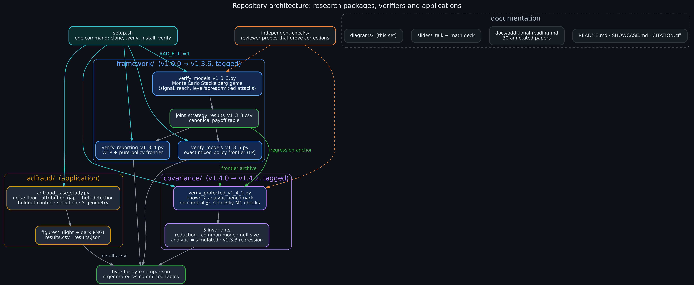
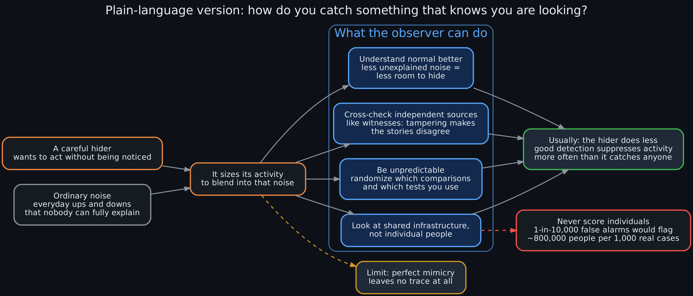

# Diagrams

Twelve Graphviz diagrams explaining the project, each as editable `.dot` source plus `.png` (160 dpi) and `.svg`. SVG is best for slides and editing.

Diagrams that show hypotheses, plans or proposed protocols say so in their own titles: the cryptoterrestrial premises are stipulated, not evidence, and nothing to the right of "Done" on the roadmap is built yet.

| # | Diagram | What it shows |
|---|---|---|
| 01 | [Architecture](01_architecture.png) | How `setup.sh`, the tagged `framework/` and `covariance/` verifiers, the `adfraud/` application and the docs fit together, and where byte-for-byte checks happen |
| 02 | [Hypotheses](02_hypotheses.png) | The four stipulated premises, the three separate variables (presence, detectability, intervention), the competing models, and the advertising counterpart H0/H1/H2 |
| 03 | [Lay explanation](03_lay_explanation.png) | Plain-language version: a careful hider, ordinary noise, the observer's four moves, and why the usual outcome is that the hider does less |
| 04 | [Model pipeline](04_model_pipeline.png) | The mathematics from background (B, τ², Σ) through hider and observer choices to s* = √(κV), λ = s²uᵀΣ⁻¹u, the mixed frontier and C* |
| 05 | [Order of moves](05_stackelberg_game.png) | The Stackelberg timing (observer commits, hider responds) and the three randomization lessons |
| 06 | [Version history](06_version_history.png) | Each release from v1.0.0 to v1.4.2 and the corrections that cross-checking forced |
| 07 | [How to run](07_how_to_run.png) | What `setup.sh` does step by step on Ubuntu 24.04 |
| 08 | [How to operationalize](08_howto_operationalize.png) | A proposed protocol for applying the framework to a real monitoring problem, with the aggregate-only guardrail |
| 09 | [Dataset selection](09_dataset_selection.png) | A decision tree for which datasets can test the framework, with candidate assessments (not yet analyzed) |
| 10 | [Dataset curation](10_dataset_curation.png) | The planned workflow from download to a frozen, auditable test bed with planted actors |
| 11 | [Ad-fraud mapping](11_adfraud_mapping.png) | Framework concepts mapped onto advertising, with the case-study numbers |
| 12 | [Future directions](12_future_directions.png) | Roadmap: done, next, later, and open questions |





## Re-rendering

```bash
sudo apt install -y graphviz
./render.sh            # or: dot -Tpng -Gdpi=160 file.dot -o file.png && dot -Tsvg file.dot -o file.svg
```

Colors follow a fixed dark theme (background `#0d1117`): blue for models and the observer, green for data and verified results, amber for outputs, violet for meta-level and planned work, orange and red for the hider, risks and corrections, cyan for entry points.
